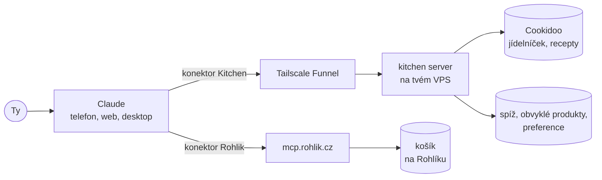

# RohlikCookidoo

Nákupní pomocník pro **Cookidoo** a **Rohlik.cz**. Řekneš, co chceš vařit, a asistent ti připraví košík. Funguje i z telefonu.

- **Nákup podle jídelníčku.** Přečte týdenní plán z Cookidoo, sečte suroviny, odečte, co máš doma, a zbytek dá do košíku.
- **Nákup podle receptu.** Jeden recept z Cookidoo nebo z libovolného webu, přepočítaný na tvůj počet porcí.
- **Poradce při nákupu.** Vybírá produkty podle tvých preferencí, navrhuje náhrady, hlídá diety, upozorní na zbytky i na minimální objednávku a pamatuje si, co obvykle kupuješ.

Výpočty dělá kód, takže jsou stejné pokaždé. Jak dobře asistent radí a vybírá produkty, záleží na modelu, který používáš. Vyzkoušené je to s Claude; servery mluví protokolem MCP, takže je může použít i jiný klient, který ho umí.

> Neoficiální osobní projekt, bez vazby na Rohlik, Vorwerk, Thermomix ani Cookidoo.
> Objednávku nikdy neodesílá. Plní jen košík, odeslání potvrzuješ ty.

## Jak to funguje



- **Kitchen** (tento projekt) počítá: součty surovin, spíž, počet balení, cenu, co v košíku chybí.
- **Rohlik** (oficiální server Rohlíku) hledá produkty a plní košík. Přihlašuješ se k němu v prohlížeči, heslo nikam nezadáváš.
- **Model** (Claude) vybírá produkty, radí a ptá se tě. Postup dostává přímo od serveru Kitchen.

## Nasazení

Potřebuješ VPS s Dockerem, účet Tailscale, Cookidoo a Rohlik.

**1. Tailscale** – v [administraci](https://login.tailscale.com/admin):

- **DNS**: zapni MagicDNS a HTTPS certifikáty.
- **Access controls**: povol Funnel.
  ```json
  "nodeAttrs": [{ "target": ["autogroup:member"], "attr": ["funnel"] }]
  ```
- **Settings → Keys**: vygeneruj auth key.

**2. VPS**

```bash
git clone https://github.com/stepanbeseda/RohlikCookidoo.git
cd RohlikCookidoo
cp .env.example .env && chmod 600 .env
openssl rand -hex 32
```

Do `.env` vyplň:

| Proměnná | Hodnota |
|---|---|
| `COOKIDOO_EMAIL`, `COOKIDOO_PASSWORD` | přihlášení ke Cookidoo |
| `MCP_AUTH_TOKEN` | výstup z `openssl rand -hex 32` |
| `TS_AUTHKEY` | auth key z Tailscale |
| `TS_HOSTNAME` | název stroje, výchozí `kitchen`; jen malá písmena, číslice a pomlčky |

```bash
docker compose up -d --build
docker compose exec tailscale tailscale funnel status
```

Druhý příkaz vypíše tvou adresu. Na `https://ADRESA/health` má být `ok` (první certifikát může trvat až deset minut).

**3. Claude** – v **Settings → Connectors → Add custom connector** přidej:

| Název | URL |
|---|---|
| Kitchen | `https://ADRESA/MCP_AUTH_TOKEN/mcp` |
| Rohlik | `https://mcp.rohlik.cz/mcp` |

Hotovo. Napiš Claudovi „nakup mi na tento týden“.

## Použití

| Řekni | Co se stane |
|---|---|
| „nakup mi na tento týden“ / „na příští týden“ | nákup podle kalendáře v Cookidoo |
| „nakup na recept r117476 pro 3 porce“ | jeden recept, přepočítaný na porce |
| pošli odkaz na recept | recept z libovolného webu |
| „co mám v plánu na tento týden?“ | jen vypíše jídelníček |
| „najdi levnější variantu“ / „je to i bez laktózy?“ | porovná produkty a navrhne náhradu |
| „co je z toho ve slevě?“ | zohlední akce na Rohlíku |
| „nastav mi spíž“ | dotazník: co máš vždy doma |
| „rýži mám vždycky“ / „na máslo se ptej“ | úprava spíže |
| „vždycky ber BIO“ / „nejím lepek“ | trvalá preference |
| „tu smetanu už nekupuj“ | zapomene obvyklý produkt |

Při prvním nákupu ti Claude nabídne dotazník na spíž. Po každém potvrzeném nákupu si pamatuje, které produkty jsi koupil, a příště je nabídne jako první.

Poslední tři řádky tabulky jsou příklady rad, které stojí na úsudku modelu a na nástrojích Rohlíku. Kód tohoto projektu je nepočítá, takže se jejich kvalita bude lišit model od modelu.

## Bezpečnost

- Adresa je veřejná a chrání ji **jen tajný token**. Bez něj server vrací 404.
- Kdo adresu s tokenem zná, vidí a může měnit tvůj jídelníček, spíž a obvyklé produkty. Ke košíku ani k účtu na Rohlíku se přes ni nedostane.
- Adresu nesdílej. Když unikne: změň `MCP_AUTH_TOKEN`, spusť `docker compose up -d` a konektor přidej znovu.
- Heslo ke Cookidoo leží na VPS v `.env`. Token se do logů nezapisuje.

## Údržba

```bash
git pull && docker compose up -d --build     # aktualizace
docker compose cp app:/data ./zaloha-data    # záloha spíže a paměti
docker compose logs --tail 50                # když něco nejde
```

| Problém | Řešení |
|---|---|
| kontejner `tailscale` se restartuje | neplatný `TS_HOSTNAME` nebo auth key; viz `docker compose logs tailscale` |
| Claude hlásí chybu přihlášení ke Cookidoo | zkontroluj e-mail a heslo v `.env` |
| týdenní plán je prázdný | recepty musí být v kalendáři na cookidoo.cz v daném týdnu |
| Rohlik chce přihlášení | v nastavení konektoru se přihlas znovu |

## Jiné způsoby provozu

<details>
<summary>Vlastní doména místo Tailscale</summary>

Před server se postaví Caddy, který si sám obstará HTTPS certifikát. Potřebuješ `DOMAIN` v `.env`, DNS záznam na VPS a otevřené porty 80 a 443. Tato varianta není vyzkoušená na skutečném serveru.

```bash
docker compose -f docker-compose.caddy.yml up -d --build
```
</details>

<details>
<summary>Jen v tailnetu, bez veřejné adresy</summary>

V `tailscale/funnel.json` smaž blok `AllowFunnel`. Server pak uvidí jen zařízení ve tvém tailnetu. Funguje v Claude Desktop a Claude Code na počítači, **v telefonu ne**: konektory v telefonu volají servery Anthropicu, které ve tvém tailnetu nejsou.
</details>

<details>
<summary>Lokálně jako plugin pro Claude Code</summary>

Vyžaduje [uv](https://docs.astral.sh/uv/). Plugin se zeptá na přihlášení ke Cookidoo a přidá příkazy `/tyden`, `/recept` a `/url`. K Rohlíku se přihlásíš přes `/mcp`.

```
/plugin marketplace add stepanbeseda/RohlikCookidoo
/plugin install rohlik-cookidoo@rohlik-cookidoo
```
</details>

<details>
<summary>Lokálně v Claude Desktop</summary>

```bash
git clone https://github.com/stepanbeseda/RohlikCookidoo.git && cd RohlikCookidoo && uv sync
```

Do `mcpServers` v `claude_desktop_config.json` přidej a aplikaci restartuj:

```json
"kitchen": {
  "command": "/cesta/k/projektu/.venv/bin/python",
  "args": ["/cesta/k/projektu/server.py"],
  "env": {
    "COOKIDOO_EMAIL": "tvuj@email.com",
    "COOKIDOO_PASSWORD": "tvoje_heslo",
    "DATA_DIR": "/cesta/k/projektu"
  }
}
```

Rohlík přidej jako konektor s URL `https://mcp.rohlik.cz/mcp`.
</details>

## Omezení

- Cookidoo nemá veřejné API; použitá knihovna `cookidoo-api` se může kdykoli rozbít. Rohlík svůj server označuje jako experimentální.
- Spíž nezná množství: „máslo“ ve spíži znamená „mám doma“, ať recept chce 50 g nebo 500 g. Claude na větší množství upozorní.
- Podobné suroviny se nesčítají („cibule“ a „žlutá cibule“, lžíce a gramy téže suroviny).
- Pády českých slov se sjednocují zjednodušeně, u neobvyklých slov se dvě podoby téže suroviny spojit nemusí.

## Vývoj

```bash
uv sync --extra dev
uv run ruff check . && uv run pytest
```

Kód je v `rohlik_cookidoo/`, vstupní bod je `server.py`. Testy, lint a sestavení Docker obrazu běží na GitHubu při každém pull requestu.

## Licence

[MIT](LICENSE)
